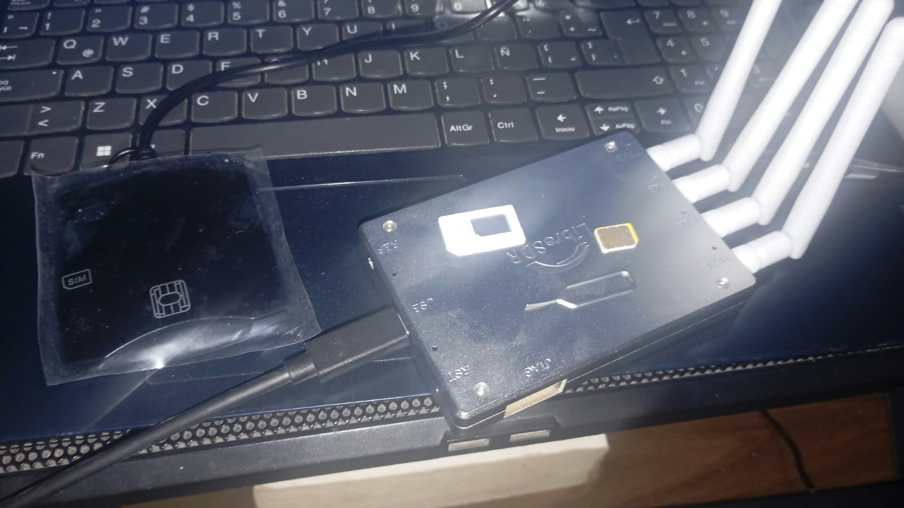
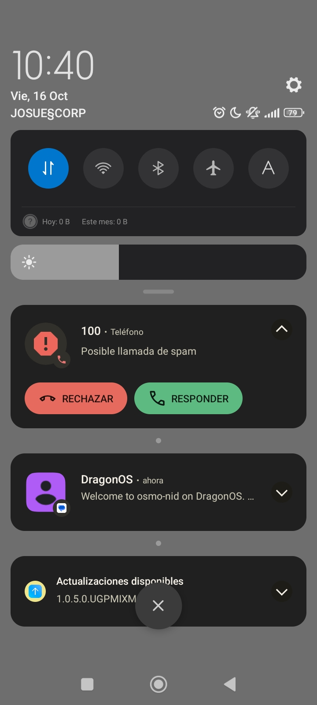

# Red privada 2G con una USIM

Personalización de una USIM en GRSIMWrite, generación de credenciales Milenage y registro del abonado 501 en una red Osmocom con LibreSDR Mini B220. Este tutorial continúa el [proyecto con SIM comercial](https://josueeeoo-0.github.io/red-privada-2g-osmocom-sim-comercial/).

## Resultado

- Identidad privada MCC 999 / MNC 99, IMSI `999990000000001`.
- Credenciales Milenage configuradas en la tarjeta y OsmoHLR.
- Autenticación requerida en OsmoMSC.
- Abonado registrado con número interno `501` y llamada entrante del número `100`.
- A5/0 en esta prueba: el enlace de radio no está cifrado.

## Tutorial

El recorrido completo está en [Inicio](docs/index.md), con capítulos sobre [generación de claves](docs/01-claves.md), [programación de la USIM](docs/02-usim.md), [configuración de red](docs/03-red.md), [OsmoHLR](docs/04-hlr.md), [OsmoMSC](docs/05-msc.md), [verificación](docs/06-prueba.md) y [referencias y alcance](docs/07-referencias.md).

## Autor y licencia

Autor: **Josue Giraldo Moya**. Código y documentación bajo la licencia MIT incluida. Marcas, normas y programas citados pertenecen a sus titulares. Uso educativo del espectro con aislamiento de RF o las autorizaciones correspondientes.
