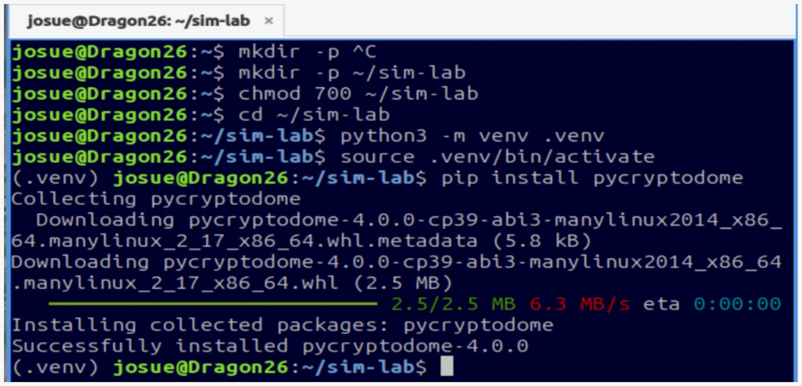
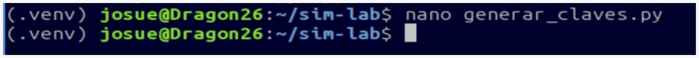
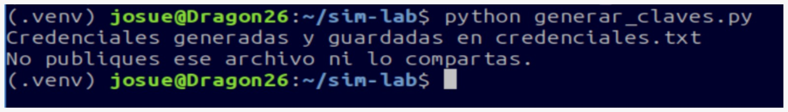
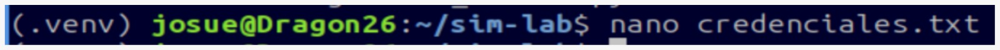
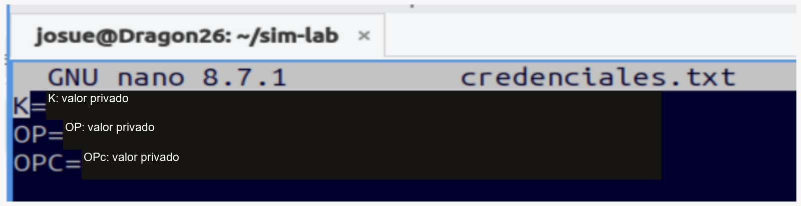

# 1. Generación de K, OP y OPc

Antes de escribir la tarjeta, se preparan las credenciales. El mismo **K** y el mismo **OPc** deben utilizarse después en GRSIMWrite y en OsmoHLR.

| Nombre | Qué representa | Dónde se introduce |
|---|---|---|
| **K** | Clave secreta del abonado, 16 bytes | Campo **Ki** de GRSIMWrite y `k` del HLR |
| **OP** | Parámetro de operador para Milenage, 16 bytes | Se conserva para derivar OPc; no se selecciona en el modo OPc |
| **OPc** | Parámetro derivado de K y OP, 16 bytes | Campo **OPC** de GRSIMWrite y `opc` del HLR |

Cada valor ocupa **32 caracteres hexadecimales**. La derivación utiliza `OPc = AES-128(K, OP) XOR OP`, conforme a [3GPP TS 35.206, sección 4.1](https://www.etsi.org/deliver/etsi_ts/135200_135299/135206/18.00.00_60/ts_135206v180000p.pdf).

## Paso 1. Preparar el entorno

En DragonOS se crea una carpeta privada y un entorno virtual de Python:

```bash title="Terminal de DragonOS"
mkdir -p ~/sim-lab
chmod 700 ~/sim-lab
cd ~/sim-lab
python3 -m venv .venv
source .venv/bin/activate
pip install pycryptodome
```

<figure markdown="1">
[{ width="500" loading="lazy" }](assets/images/python-01.png)
<figcaption>Preparación del entorno. La captura contiene además un intento inicial de mkdir; el bloque anterior presenta la secuencia limpia. · Pulsa la imagen para ampliarla.</figcaption>
</figure>

El entorno virtual mantiene las dependencias del generador separadas de las herramientas del sistema. `chmod 700` limita el acceso a la carpeta en Linux.

## Paso 2. Crear el archivo del generador

```bash title="Terminal de DragonOS"
nano generar_claves.py
```

<figure markdown="1">
[{ width="500" loading="lazy" }](assets/images/python-02.png)
<figcaption>Apertura del archivo que contendrá el generador. · Pulsa la imagen para ampliarla.</figcaption>
</figure>

Copia este código y guarda con **Ctrl + O**, **Enter** y **Ctrl + X**:

```python title="generar_claves.py"
from Crypto.Cipher import AES
from secrets import token_bytes
from pathlib import Path

def derive_opc(k, op):
    encrypted = AES.new(k, AES.MODE_ECB).encrypt(op)
    return bytes(a ^ b for a, b in zip(encrypted, op))

k = token_bytes(16)
op = token_bytes(16)
opc = derive_opc(k, op)

out = (
    f"K={k.hex().upper()}\n"
    f"OP={op.hex().upper()}\n"
    f"OPC={opc.hex().upper()}\n"
)

Path("credenciales.txt").write_text(out)
Path("credenciales.txt").chmod(0o600)

print("Credenciales generadas y guardadas en credenciales.txt")
print("No publiques ese archivo ni lo compartas.")
```

`token_bytes(16)` obtiene valores aleatorios del sistema. AES procesa un bloque de 16 bytes; el XOR con OP produce OPc. Usar ECB aquí corresponde a esa operación de un solo bloque definida por Milenage, no al cifrado de archivos.

También se incluye el archivo listo para copiar en `scripts/generar_claves.py` dentro del repositorio.

## Paso 3. Ejecutar una vez

```bash title="Terminal de DragonOS"
python generar_claves.py
```

<figure markdown="1">
[{ width="500" loading="lazy" }](assets/images/python-03.png)
<figcaption>El programa confirma que guardó credenciales.txt sin imprimir sus valores. · Pulsa la imagen para ampliarla.</figcaption>
</figure>

!!! warning "No sobrescribir las claves ya utilizadas"
    Este código se conserva tal como se utilizó en la práctica: cada ejecución crea claves nuevas y **sobrescribe** `credenciales.txt` si existe. Guarda una copia privada antes de ejecutarlo de nuevo. No regeneres las claves entre la escritura de la tarjeta y el alta en el HLR.

## Paso 4. Consultar el archivo en privado

```bash title="Terminal de DragonOS"
nano credenciales.txt
```

<figure markdown="1">
[{ width="500" loading="lazy" }](assets/images/python-04.png)
<figcaption>Consulta de las claves para copiarlas al software de personalización. · Pulsa la imagen para ampliarla.</figcaption>
</figure>

<figure markdown="1">
[{ width="500" loading="lazy" }](assets/images/python-05.png)
<figcaption>Copia pública: valores ocultos. En el equipo local se copian los valores completos. · Pulsa la imagen para ampliarla.</figcaption>
</figure>

El archivo tiene tres líneas: `K=...`, `OP=...` y `OPC=...`. Copia únicamente el valor situado después de `=`. No subas ese archivo a GitHub ni incluyas las claves en un commit. El permiso `600` limita su lectura y escritura al propietario en Linux; en Windows se necesita gestionar las ACL del archivo.

**Siguiente etapa:** [personalizar la USIM en GRSIMWrite](02-usim.md).
