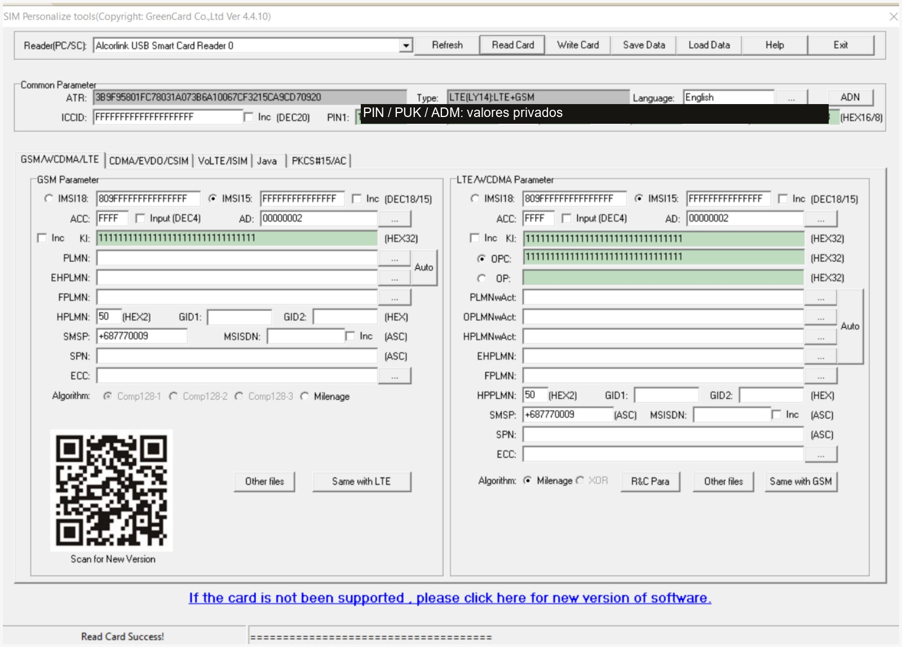
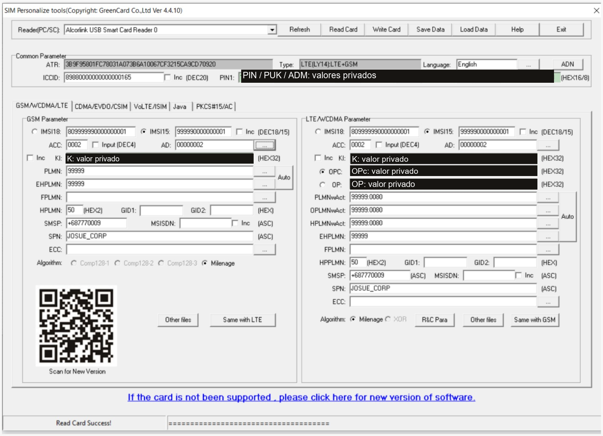

# 2. Programación de la USIM para GSM 2G

## Estado inicial de la tarjeta

<figure markdown="1">
[{ width="500" loading="lazy" }](assets/images/usim-antes.png)
<figcaption>antes_de_los_cambios: lectura inicial. Los códigos de administración se ocultan en la copia pública. · Pulsa la imagen para ampliarla.</figcaption>
</figure>

La tarjeta ya tiene el **COS** instalado. Aquí se personalizan sus datos; no se instala un sistema operativo nuevo. GRSIMWrite identifica la tarjeta como `LTE [LY14]: LTE+GSM`. Esa etiqueta no convierte la red en LTE: una USIM puede utilizarse en GSM, y se mantienen coherentes ambos perfiles que muestra el programa.

## Paso 1. Leer y respaldar

1. Conectar el lector y colocar la tarjeta.
2. Seleccionar el lector PC/SC en GRSIMWrite.
3. Pulsar **Read Card**.
4. Guardar con **Save Data** una copia privada de los datos iniciales.

**Por qué:** se trabaja sobre los datos reales de la tarjeta y se conserva una referencia anterior a los cambios. El respaldo no garantiza la lectura de secretos protegidos.

## Paso 2. Definir la identidad del laboratorio

| Dato | Valor de la guía | Por qué se utiliza |
|---|---|---|
| MCC | `999` | Código para uso interno de redes privadas |
| MNC | `99` | Identificador interno de red, de dos dígitos |
| PLMN | `99999` | MCC y MNC concatenados |
| IMSI | `999990000000001` | Identidad de este abonado |
| SPN | `JOSUE_CORP` | Nombre almacenado en la tarjeta |

El IMSI se divide en **999 / 99 / 0000000001**: MCC, MNC y número de abonado. La [UIT, boletín 1156, página 5](https://www.itu.int/dms_pub/itu-t/opb/sp/T-SP-OB.1156-2018-OAS-PDF-E.pdf) establece MCC 999 para uso interno y recomienda MNC 99 o 999 para pruebas. Esa identidad debe coincidir después con el PLMN anunciado por la red.

## Paso 3. Completar Common Parameter

| Campo visible | Qué introducir o conservar | Explicación |
|---|---|---|
| **ATR** | Valor leído | Describe la comunicación inicial con la tarjeta; no se inventa |
| **Type** | Tipo detectado y compatible con la tarjeta | Permite que el programa use su procedimiento de personalización |
| **ICCID** | Conservar uno válido; si está en F, inicializar uno de laboratorio | Identifica la tarjeta física, no al abonado |
| **PIN1 / PIN2** | Conservar los valores conocidos | Códigos de acceso a funciones de la tarjeta |
| **PUK1 / PUK2** | Conservar y anotar en privado | Desbloquean sus PIN correspondientes |
| **ADM** | Credencial confirmada por el proveedor | Autoriza modificaciones protegidas |
| **Language** | Conservar | No decide la autenticación GSM |
| **Inc** | Desmarcado | Se escribe una sola tarjeta |

Como ejemplo local de ICCID, la guía propuso **`8988000000000000016`**, de 19 dígitos y con control Luhn correcto. Es un identificador ficticio para laboratorio: **no es una asignación comercial** ni debe repetirse entre tarjetas. La captura final documenta el contenido introducido durante la práctica; no certifica la asignación ni el dígito de control de ese contenido. ICCID e IMSI son datos distintos, descritos en [TS 51.011, sección 10](https://www.etsi.org/deliver/etsi_ts/151000_151099/151011/04.15.00_60/ts_151011v041500p.pdf).

No se debe adivinar el ADM ni copiar un supuesto valor universal: varios intentos incorrectos pueden bloquear el acceso administrativo. Que un campo muestre un ADM no demuestra que haya sido verificado. [Osmocom, verificación de ADM](https://downloads.osmocom.org/docs/pysim/master/html/shell.html#verify-adm).

## Paso 4. Identidad y claves en LTE/WCDMA Parameter

Se comienza por el panel derecho para usar después **Same with LTE** hacia el panel GSM. El nombre del panel corresponde al perfil de la tarjeta; el acceso de radio de este proyecto sigue siendo 2G.

| Campo visible | Valor que se introduce | Por qué |
|---|---|---|
| **IMSI15** | Seleccionar y escribir `999990000000001` | Entrada directa de los 15 dígitos decimales |
| **IMSI18** | No introducir otro identificador | Es la representación codificada del mismo IMSI |
| **Ki** | Valor de `K=` del archivo privado | Es la clave secreta K que generó Python |
| Selector **OPC** | Seleccionado | Se utiliza el parámetro ya derivado |
| **OPC** | Valor de `OPC=` del mismo archivo | Debe corresponder a esa misma K |
| Selector **OP** | No seleccionado | La configuración utiliza OPc |
| **Algorithm** | **Milenage** | Algoritmo correspondiente a K y OPc |
| **Inc** | Desmarcado | Sin incremento automático |

**K se llama Ki en la pantalla.** Se pegan 32 caracteres hexadecimales, sin el prefijo `K=`, comillas ni espacios. OP y OPc no son intercambiables. La fórmula y sus parámetros están definidos en [TS 35.206, sección 4.1](https://www.etsi.org/deliver/etsi_ts/135200_135299/135206/18.00.00_60/ts_135206v180000p.pdf).

## Paso 5. Redes preferidas para acceso GSM

| Campo | Valor | Función |
|---|---|---|
| **PLMNwAct** | `99999:0080` | Red preferida con tecnología de acceso GSM |
| **OPLMNwAct** | `99999:0080` | Preferencia gestionada por el operador |
| **HPLMNwAct** | `99999:0080` | Preferencia de acceso de la red de origen |
| **EHPLMN** | `99999` | Red equivalente a la de origen; redundante en este caso sencillo |
| **FPLMN** | Vacío | La red de laboratorio no debe quedar prohibida |
| **SPN** | `JOSUE_CORP` | Nombre del proveedor almacenado en la USIM |

`99999` es el PLMN y `0080` es la máscara GSM en este formato. Si el programa ofrece el botón **…**, se puede usar su editor de listas. El formato utilizado por GRSIMWrite está documentado en la [guía de iothon](https://github.com/iothon/operator/wiki/Writing-your-own-SIM-cards). Las funciones de esos archivos se especifican en [TS 31.102](https://www.etsi.org/deliver/etsi_ts/131100_131199/131102/12.10.00_60/ts_131102v121000p.pdf).

Vaciar FPLMN debe producir una lista vacía al volver a leer la tarjeta. Un cuadro vacío no demuestra por sí mismo que el programa haya borrado el archivo.

## Paso 6. ACC y AD

| Campo | Valor recomendado en esta guía | Explicación |
|---|---|---|
| **ACC** | `0001`, con **Input (DEC4)** desmarcado | Máscara hexadecimal: clase normal de acceso 0 |
| **AD** | `00000002`, cuatro bytes | Operación normal y MNC de dos dígitos |

En la ventana de **AD** se selecciona **00: normal operation** y **MNC:2 (MCC+MNC:5)**. Se confirma con **OK**. Ese botón actualiza el formulario; la tarjeta se escribe después mediante **Write Card**. Se aplica lo mismo a ambos paneles.

El MNC tiene dos dígitos porque usamos **99**; junto con MCC **999** suma cinco. EF.AD permite especificar esa longitud. [Implementación de EF.AD en pySim](https://github.com/osmocom/pysim/blob/master/pySim/legacy/cards.py).

!!! note "Diferencia entre la guía y la captura final"
    La captura final muestra **ACC 0002** en ambos perfiles: corresponde a la clase normal 1. La guía había propuesto **0001**, clase normal 0. Ambas son clases ordinarias; se conserva la captura real y se explicita la diferencia. No se utiliza `FFFF` como máscara de ejemplo para el abonado. [TS 31.102, EF.ACC](https://www.etsi.org/deliver/etsi_ts/131100_131199/131102/12.10.00_60/ts_131102v121000p.pdf).

## Paso 7. Copiar al panel GSM y revisar

Pulsa **Same with LTE**, situado debajo del panel GSM. Comprueba el resultado campo a campo:

| Campo GSM | Resultado esperado |
|---|---|
| **IMSI15** | `999990000000001` |
| **Ki** | La misma K del panel derecho |
| **Algorithm** | Milenage |
| **PLMN** | `99999` |
| **EHPLMN** | `99999`, si se utiliza |
| **FPLMN** | Vacío |
| **ACC / AD** | Clase normal elegida y `00000002` |
| **SPN** | `JOSUE_CORP` |

Se comprueba la copia porque su alcance depende del programa y del COS. En este modelo el panel GSM no expone un campo OPc independiente; no se debe pegar OPc en otro campo. La prueba posterior de registro comprueba el funcionamiento del conjunto tarjeta–teléfono–red.

## Paso 8. Conservar el resto

| Campo | Acción para esta etapa | Motivo |
|---|---|---|
| **HPPLMN** | Conservar `50` si es el valor leído | Es un período de búsqueda, no el identificador PLMN |
| **SMSP** | Conservar inicialmente | Parámetros de SMS; el valor visible no se propone como SMSC universal |
| **MSISDN** | Puede quedar vacío en la tarjeta | El número interno se asignará en el HLR |
| **GID1 / GID2** | Conservar | No son necesarios para este alta sencilla |
| **ECC** | Conservar | No alterar la lista de números de emergencia |
| **R&C Para** | Conservar los valores Milenage estándar del proveedor | No cambiar las constantes del algoritmo |
| Otras pestañas | Conservar | No se configura VoLTE, ISIM, Java ni CDMA |

Conservar significa mantener los datos leídos, no borrar cuadros indiscriminadamente. [TS 51.011, archivos de la SIM](https://www.etsi.org/deliver/etsi_ts/151000_151099/151011/04.15.00_60/ts_151011v041500p.pdf).

## Paso 9. Escribir y volver a leer

1. Comparar K y OPc con **el mismo** archivo privado.
2. Confirmar IMSI, algoritmo, PLMN y longitud del MNC.
3. Guardar la configuración con **Save Data**, de forma privada.
4. Pulsar **Write Card** y esperar el resultado sin errores.
5. Retirar y reinsertar la tarjeta en el lector.
6. Pulsar **Read Card** y comprobar los archivos legibles.

El mensaje **Read Card Success** acredita una lectura, no una escritura anterior ni la corrección de las claves. K y OPc pueden no ser legibles: su prueba funcional se completa al autenticar en la red.

## Estado final documentado

<figure markdown="1">
[{ width="500" loading="lazy" }](assets/images/usim-despues.png)
<figcaption>despues_de_los_cambios: identidad y preferencias configuradas. ACC 0002 es el valor observado en la práctica; las claves permanecen privadas. · Pulsa la imagen para ampliarla.</figcaption>
</figure>

**Siguiente etapa:** [hacer coincidir la identidad de la red](03-red.md).
