# 3. Configuración de la red en DragonOS

Se parte del [laboratorio anterior](https://josueeeoo-0.github.io/red-privada-2g-osmocom-sim-comercial/), donde ya se había validado el arranque UHD de la Mini B220. Ahora se cambia la identidad de red para que coincida con la USIM.

## Paso 1. Detener los servicios

```bash title="Terminal de DragonOS"
sudo osmo-nid-stop
```

<figure markdown="1">
[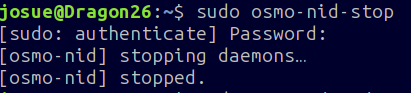{ width="500" loading="lazy" }](assets/images/paso-01.png)
<figcaption>La red se detiene antes de editar su configuración.</figcaption>
</figure>

## Paso 2. Respaldar config.yml

```bash title="Terminal de DragonOS"
sudo cp -a /etc/osmo-nid/config.yml /etc/osmo-nid/config.yml.antes-usim.bak
```

<figure markdown="1">
[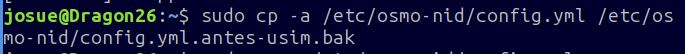{ width="500" loading="lazy" }](assets/images/paso-02.png)
<figcaption>Copia de la configuración anterior a la nueva USIM.</figcaption>
</figure>

<figure markdown="1">
[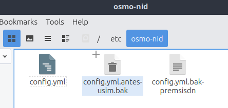{ width="500" loading="lazy" }](assets/images/paso-03.png)
<figcaption>El archivo de respaldo aparece en /etc/osmo-nid.</figcaption>
</figure>

## Paso 3. Abrir la configuración

```bash title="Terminal de DragonOS"
sudo nano /etc/osmo-nid/config.yml
```

<figure markdown="1">
[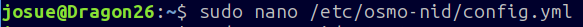{ width="500" loading="lazy" }](assets/images/paso-04.png)
<figcaption>Edición del archivo fuente de osmo-nid.</figcaption>
</figure>

### Configuración antes del cambio

El estado anterior anunciaba MCC `001`, MNC `01` y el nombre `Test`.

<figure markdown="1">
[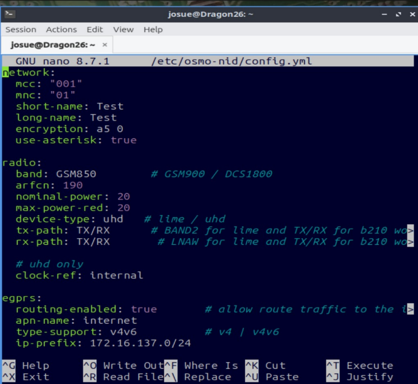{ width="500" loading="lazy" }](assets/images/paso-05.png)
<figcaption>Bloques network y radio antes del cambio</figcaption>
</figure>

<figure markdown="1">
[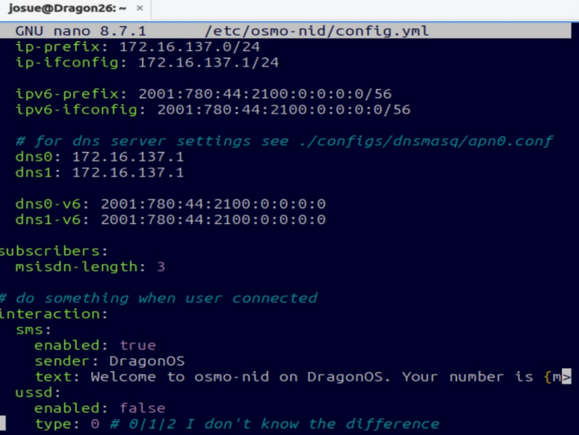{ width="500" loading="lazy" }](assets/images/paso-06.png)
<figcaption>Bloques egprs subscribers e interaction</figcaption>
</figure>

<figure markdown="1">
[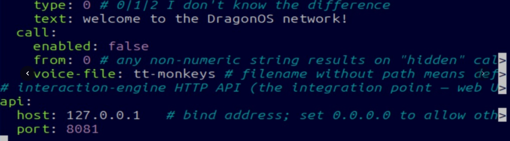{ width="500" loading="lazy" }](assets/images/paso-07.png)
<figcaption>Bloques call y api antes del cambio</figcaption>
</figure>

## Paso 4. Cambiar el bloque network

Se modifican MCC, MNC y los nombres. El resto del bloque se conserva:

```yaml title="/etc/osmo-nid/config.yml"
network:
  mcc: "999"
  mnc: "99"
  short-name: JOSUE_CORP
  long-name: JOSUE_CORP
  encryption: a5 0
  use-asterisk: true
```

| Opción | Valor | Motivo |
|---|---|---|
| `mcc` | `"999"` | Coincide con los primeros tres dígitos del IMSI |
| `mnc` | `"99"` | Coincide con sus siguientes dos dígitos |
| `short-name` / `long-name` | `JOSUE_CORP` | Nombre que anuncia la red |
| `encryption` | `a5 0` | Estado de esta prueba: sin cifrado de radio |
| `use-asterisk` | `true` | Conserva la integración de telefonía existente |

**Autenticación y cifrado son distintos.** A5/0 no desactiva el uso de K y OPc en el HLR; indica ausencia de cifrado en el enlace. [Manual de OsmoMSC, autenticación y cifrado](https://downloads.osmocom.org/docs/osmo-msc/master/osmomsc-usermanual.pdf).

### Configuración después del cambio

<figure markdown="1">
[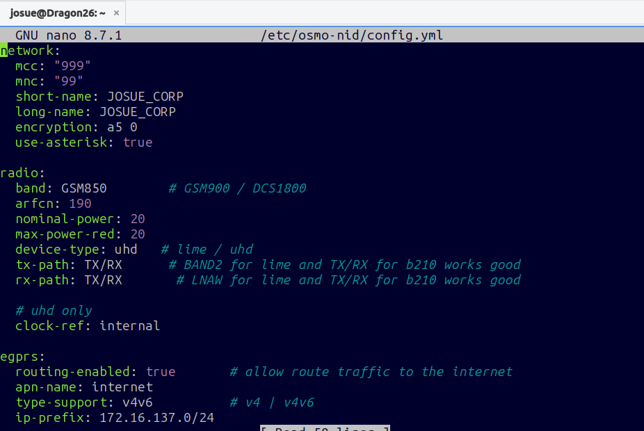{ width="500" loading="lazy" }](assets/images/paso-08.png)
<figcaption>Network con MCC 999 MNC 99 y nombre JOSUE_CORP</figcaption>
</figure>

<figure markdown="1">
[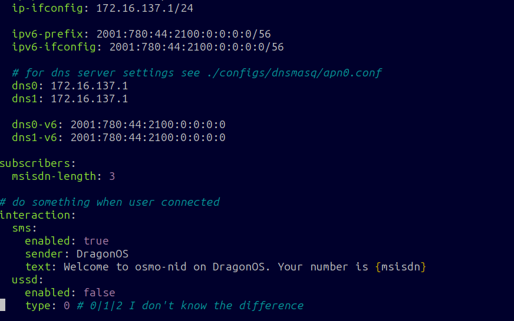{ width="500" loading="lazy" }](assets/images/paso-09.png)
<figcaption>Configuración de datos y mensaje de bienvenida conservada</figcaption>
</figure>

<figure markdown="1">
[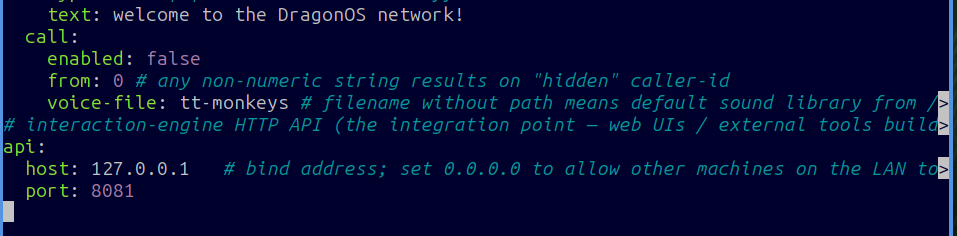{ width="500" loading="lazy" }](assets/images/paso-10.png)
<figcaption>API local y opciones de interacción conservadas</figcaption>
</figure>

Guardar con **Ctrl + O**, **Enter** y salir con **Ctrl + X**.

## Paso 5. Conservar la radio que ya funcionaba

| Ajuste | Valor del laboratorio |
|---|---|
| `device-type` | `uhd` |
| `band` | `GSM850` |
| `arfcn` | `190` |
| `tx-path` / `rx-path` | `TX/RX` |
| `clock-ref` | `internal` |

Cambiar de SIM no exige cambiar esos parámetros. Su selección se documentó en el [primer proyecto](https://josueeeoo-0.github.io/red-privada-2g-osmocom-sim-comercial/03-configuracion-peru/). El ARFCN 190 es el canal usado, **no una afirmación de disponibilidad ni de autorización de espectro**.

## Paso 6. Conectar la Mini B220 y arrancar

La SDR debe estar conectada y accesible desde DragonOS antes del arranque. En una máquina virtual, el USB debe estar asignado al sistema invitado.

```bash title="Terminal de DragonOS"
sudo osmo-nid-start
```

<figure markdown="1">
[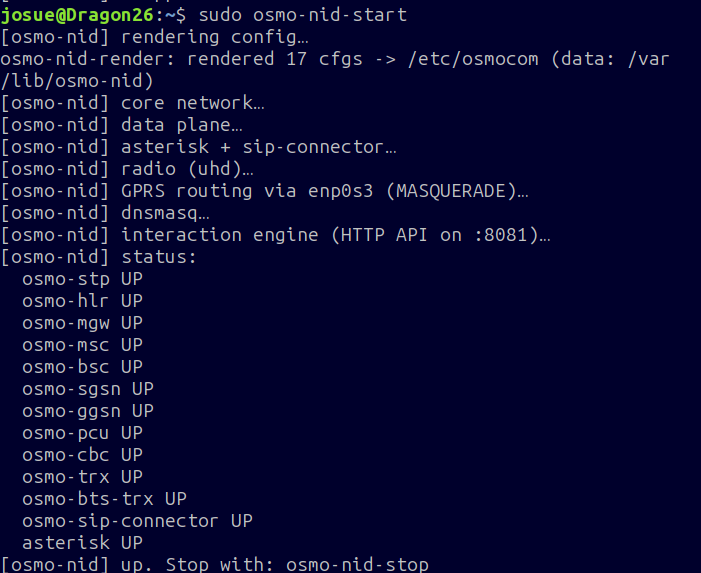{ width="500" loading="lazy" }](assets/images/paso-11.png)
<figcaption>La captura muestra osmo-trx y osmo-bts-trx activos, junto con el núcleo.</figcaption>
</figure>

Si `osmo-trx` queda en `DOWN`, consultar el registro antes de atribuirlo a la USIM:

```bash title="Terminal de DragonOS"
sudo tail -n 60 /var/log/osmo-nid/osmo-trx.log
```

Un estado `UP` acredita el arranque del proceso, no el registro de un teléfono.

**Siguiente etapa:** [registrar el abonado en OsmoHLR](04-hlr.md). Mantener el teléfono en modo avión durante la preparación.
