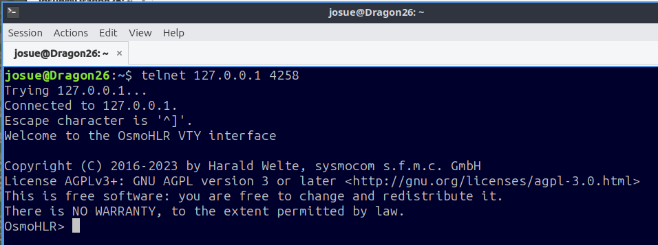
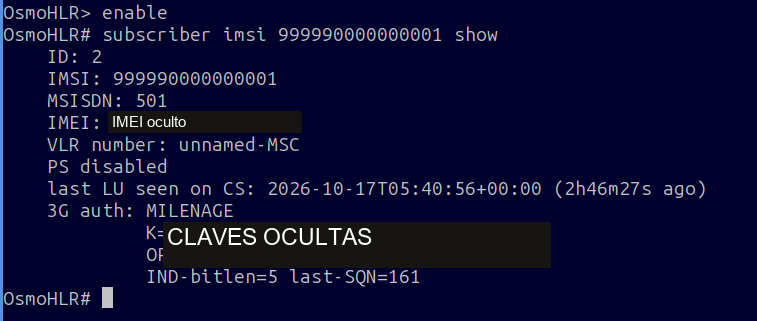

# 4. Alta del abonado en OsmoHLR

El HLR debe conocer el IMSI y las mismas credenciales que se escribieron en la tarjeta. Aquí se asigna el número interno **501**.

## Paso 1. Entrar a la consola

```bash title="Terminal de DragonOS"
telnet 127.0.0.1 4258
```

<figure markdown="1">
[{ width="500" loading="lazy" }](assets/images/paso-12.png)
<figcaption>Acceso local al HLR en el puerto 4258.</figcaption>
</figure>

Los comandos siguientes se introducen en la consola de **OsmoHLR**, no en la terminal Bash.

## Paso 2. Consultar si existe el IMSI

```text title="Consola OsmoHLR"
enable
subscriber imsi 999990000000001 show
```

```text title="Respuesta de OsmoHLR"
% No subscriber for imsi = '999990000000001'
```

Esta respuesta indica que aún no existe el abonado.

## Paso 3. Crear el abonado

```text title="Consola OsmoHLR"
subscriber imsi 999990000000001 create
```

El IMSI debe ser exactamente el de **IMSI15** en GRSIMWrite. Si el abonado ya existe, no hay que crearlo de nuevo.

## Paso 4. Asignar el número interno

```text title="Consola OsmoHLR"
subscriber imsi 999990000000001 update msisdn 501
```

`501` es el número elegido dentro de esta red. Debe estar libre; no es un número público ni el ICCID.

## Paso 5. Registrar K y OPc

```text title="Consola OsmoHLR · sustituir los marcadores antes de ejecutar"
subscriber imsi 999990000000001 update aud3g milenage k TU_K opc TU_OPC
```

| Marcador | Qué se introduce |
|---|---|
| `TU_K` | Los 32 caracteres de `K=` que también se pegaron en **Ki** |
| `TU_OPC` | Los 32 caracteres de `OPC=` del mismo archivo |

Sin prefijos, espacios internos ni comillas. No se ejecuta el comando con los marcadores sin sustituir.

Aunque el comando diga **aud3g**, OsmoHLR también utiliza esas credenciales Milenage para GSM 2G. No se está desplegando una red 3G. [Manual de OsmoHLR](https://downloads.osmocom.org/docs/osmo-hlr/1.9.2/osmohlr-usermanual.pdf).

## Paso 6. Permitir los servicios de circuitos

```text title="Consola OsmoHLR"
subscriber imsi 999990000000001 update network-access-mode cs
```

`cs` permite el dominio de circuitos de esta prueba de voz y SMS. No habilita datos móviles. [Referencia VTY de OsmoHLR](https://downloads.osmocom.org/docs/osmo-hlr/master/osmohlr-vty-reference.pdf).

## Paso 7. Consultar el resultado

```text title="Consola OsmoHLR"
subscriber imsi 999990000000001 show
```

<figure markdown="1">
[{ width="500" loading="lazy" }](assets/images/paso-13.png)
<figcaption>Consulta del abonado: IMSI, número interno 501 y autenticación Milenage.</figcaption>
</figure>

| Dato observado | Significado |
|---|---|
| IMSI `999990000000001` | Existe el abonado esperado |
| MSISDN `501` | Número interno asignado |
| `3G auth: MILENAGE` | Se guardaron las credenciales del algoritmo |
| `PS disabled` | No se habilitó el dominio de datos |
| K / OPc | Deben coincidir con la tarjeta; no se publican |

Los cambios de abonado se guardan en la base de datos del HLR. No se necesita `write file` para dar de alta esos datos. Conviene comprobar su conservación después de reiniciar el envoltorio de la red.

Para salir:

```text title="Consola OsmoHLR"
exit
```

**Siguiente etapa:** [exigir autenticación en OsmoMSC](05-msc.md).
