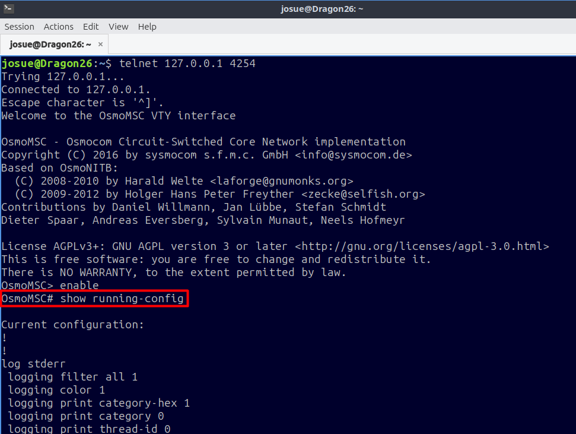
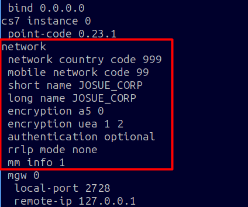
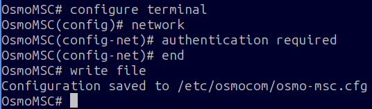
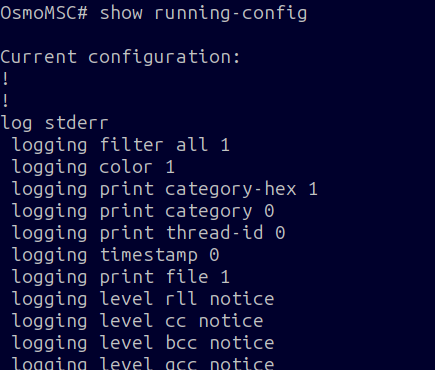
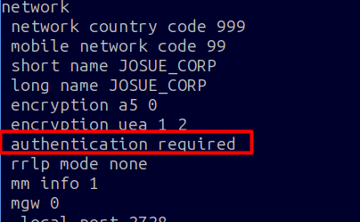

# 5. Autenticación obligatoria en OsmoMSC

La tarjeta y el HLR ya tienen credenciales. Ahora se revisa la política del MSC.

## Paso 1. Entrar y consultar

```bash title="Terminal de DragonOS"
telnet 127.0.0.1 4254
```

```text title="Consola OsmoMSC"
enable
show running-config
```

<figure markdown="1">
[{ width="500" loading="lazy" }](assets/images/paso-14.png)
<figcaption>Acceso al MSC y consulta de la configuración efectiva. · Pulsa la imagen para ampliarla.</figcaption>
</figure>

<figure markdown="1">
[{ width="500" loading="lazy" }](assets/images/paso-15.png)
<figcaption>Estado inicial: MCC y MNC correctos, pero autenticación opcional. · Pulsa la imagen para ampliarla.</figcaption>
</figure>

Con `authentication optional`, el MSC puede aceptar abonados que no tengan claves. Si un abonado sí tiene credenciales en el HLR, se comprueban. Con `required`, también se rechazan los abonados sin claves. [Manual de OsmoMSC, autenticación en 2G](https://downloads.osmocom.org/docs/osmo-msc/master/osmomsc-usermanual.pdf).

## Paso 2. Exigir autenticación

```text title="Consola OsmoMSC"
configure terminal
network
authentication required
end
write file
```

<figure markdown="1">
[{ width="500" loading="lazy" }](assets/images/paso-16.png)
<figcaption>El MSC confirma que guarda /etc/osmocom/osmo-msc.cfg. · Pulsa la imagen para ampliarla.</figcaption>
</figure>

| Comando | Función |
|---|---|
| `configure terminal` | Entrar al modo de configuración |
| `network` | Seleccionar los parámetros de red |
| `authentication required` | Exigir autenticación en 2G |
| `end` | Volver al modo de administración |
| `write file` | Guardar la configuración del servicio |

## Paso 3. Comprobar el cambio activo

```text title="Consola OsmoMSC"
show running-config
```

<figure markdown="1">
[{ width="500" loading="lazy" }](assets/images/paso-17.png)
<figcaption>Consulta después de cambiar la política. · Pulsa la imagen para ampliarla.</figcaption>
</figure>

<figure markdown="1">
[{ width="500" loading="lazy" }](assets/images/paso-18.png)
<figcaption>Estado final: autenticación requerida, con A5/0 conservado para esta prueba. · Pulsa la imagen para ampliarla.</figcaption>
</figure>

Debe aparecer:

```text title="Fragmento esperado · el orden de las líneas puede variar"
network
 network country code 999
 mobile network code 99
 authentication required
 encryption a5 0
```

La línea `encryption a5 0` significa **sin cifrado de radio**. No se presenta esta prueba como una comunicación cifrada. La autenticación y el cifrado son mecanismos diferentes.

## Persistencia al volver a arrancar

`osmo-nid-start` genera los archivos de `/etc/osmocom` a partir de su configuración y plantillas. Aunque `write file` guarde el MSC, un arranque posterior podría reemplazarlo. En esta sesión se comprobó el cambio activo; **no se documentó una prueba de persistencia tras reiniciar**.

Antes de reutilizar el laboratorio tras un reinicio, volver a consultar `show running-config` y confirmar `authentication required`. Si reaparece `optional`, aplicar nuevamente el paso 2 y localizar la plantilla de `osmo-nid-render` para hacer persistente el ajuste en esa instalación. No se propone una clave YAML no verificada.

Para terminar esta etapa:

```text title="Consola OsmoMSC"
exit
```

**Siguiente etapa:** [registrar el teléfono y generar la llamada](06-prueba.md).
