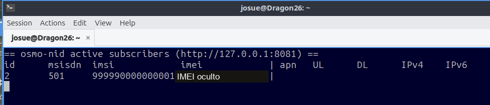

# 6. Registro del teléfono y llamada de prueba

## Paso 1. Abrir el monitor

En una terminal de DragonOS:

```bash title="Terminal de DragonOS"
osmo-nid-mon
```

<figure markdown="1">
[{ width="500" loading="lazy" }](assets/images/paso-21.png)
<figcaption>Esta captura se coloca antes del resultado del monitor para seguir el orden del procedimiento. · Pulsa la imagen para ampliarla.</figcaption>
</figure>

## Paso 2. Seleccionar la red desde el teléfono

1. Colocar la USIM programada con el teléfono apagado y encenderlo.
2. Introducir el PIN si lo solicita.
3. Seleccionar **solo 2G**.
4. Desactivar el modo avión y buscar redes manualmente.
5. Elegir **JOSUE_CORP** o el PLMN **99999**.

La configuración del menú del Redmi se explica en el [proyecto anterior](https://josueeeoo-0.github.io/red-privada-2g-osmocom-sim-comercial/04-telefono/). El nombre mostrado puede depender de los datos del teléfono, de la tarjeta y del nombre enviado por la red.

## Paso 3. Comprobar el abonado registrado

<figure markdown="1">
[{ width="500" loading="lazy" }](assets/images/paso-19.png)
<figcaption>Resultado: el monitor lista IMSI 999990000000001 y MSISDN 501. El IMEI se oculta en la copia pública. · Pulsa la imagen para ampliarla.</figcaption>
</figure>

| Evidencia | Resultado |
|---|---|
| IMSI esperado | `999990000000001` |
| Número interno | `501` |
| Política del MSC documentada | `authentication required` |
| Datos móviles | No habilitados para este abonado |

La combinación de configuración y registro muestra el resultado funcional de esta sesión. No se incluye una captura de señalización para distinguir si se negoció GSM-Milenage o UMTS AKA sobre GERAN.

## Paso 4. Generar una llamada al teléfono

Abrir otra terminal y ejecutar:

```bash title="Terminal de DragonOS"
osmo-nid-call 100 501
```

<figure markdown="1">
[{ width="500" loading="lazy" }](assets/images/paso-20.png)
<figcaption>Llamada de prueba: origen 100 y destino 501. · Pulsa la imagen para ampliarla.</figcaption>
</figure>

| Argumento | Qué representa |
|---|---|
| `100` | Identidad de origen mostrada en esta prueba |
| `501` | Número interno del teléfono con la USIM |

Se utiliza el mismo mecanismo de llamada del [laboratorio inicial](https://josueeeoo-0.github.io/red-privada-2g-osmocom-sim-comercial/05-verificacion/), ahora hacia el abonado de la tarjeta programada.

## Paso 5. Observar el resultado en el teléfono

<figure markdown="1">
[{ width="300" loading="lazy" }](assets/images/llamada-telefono.png)
<figcaption>El teléfono muestra la llamada entrante y el mensaje de bienvenida de DragonOS. · Pulsa la imagen para ampliarla.</figcaption>
</figure>

La fotografía acredita la **llamada entrante** y la notificación de bienvenida recibida. No demuestra por sí sola que se contestara, que hubiera audio en ambos sentidos ni el envío de SMS desde el teléfono.

## Si el resultado no aparece

| Síntoma | Comprobación siguiente |
|---|---|
| `osmo-trx DOWN` | Conexión USB de la B220 y registro del transceptor |
| La red no aparece | Radio, banda, canal y modo 2G del teléfono |
| Red visible, registro rechazado | IMSI, K, OPc, Milenage, permisos CS y FPLMN |
| Conexión VTY rechazada | Estado del proceso y dirección/puerto de escucha |
| Registro correcto, llamada sin audio | Asterisk, MGW, RTP y rutas de voz |
| Después del reinicio aparece `optional` | Regeneración de la configuración por osmo-nid |

**Resultado de esta práctica:** una USIM personalizada, un abonado dado de alta y registrado, y una llamada entrante en la red privada 2G. [Referencias y límites de la evidencia](07-referencias.md).
